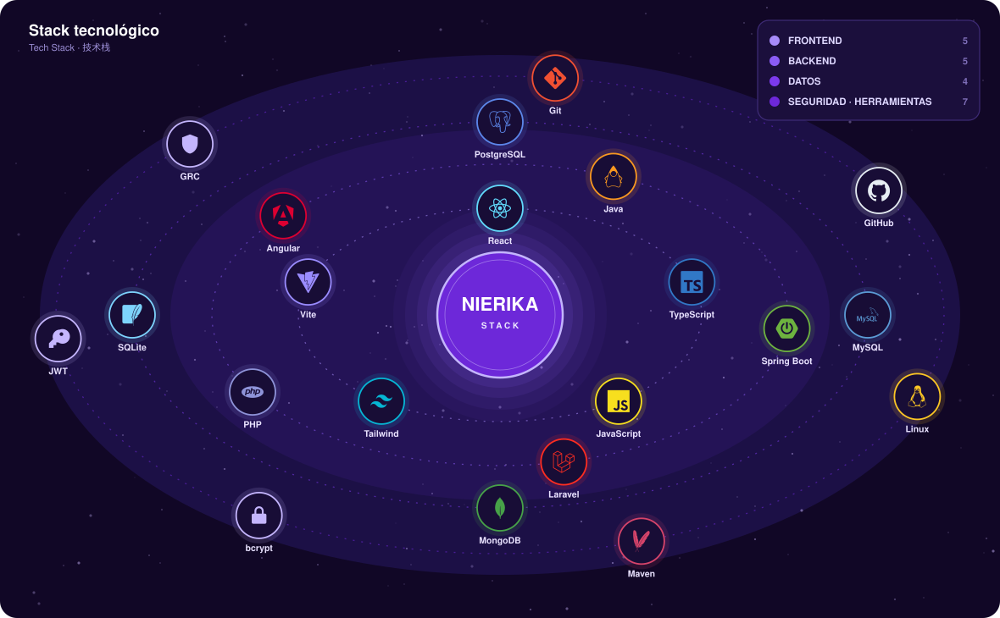

 

 

##  Sobre mí &nbsp;|&nbsp; About me &nbsp;|&nbsp; 关于我

 Estudiante de Ingeniería en Sistemas Computacionales en el Instituto Tecnológico de Oaxaca. Trabajo en desarrollo frontend y aplicaciones web, y me interesa construir software que además de funcionar sea seguro y mantenible — de ahí mi camino hacia la seguridad de aplicaciones, el GRC y las tecnologías cloud.

 Systems Engineering student at Instituto Tecnológico de Oaxaca. I work on frontend development and web applications, and I care about building software that is not only functional but also secure and maintainable — which is what draws me toward application security, GRC and cloud technologies.

 墨西哥瓦哈卡理工学院计算机系统工程专业在读学生。专注于前端开发与网页应用，致力于构建既实用又安全、易于维护的软件，并由此深入应用安全、GRC（治理、风险与合规）以及云技术领域。

 

 

##  Proyecto destacado &nbsp;|&nbsp; Featured Project &nbsp;|&nbsp; 代表项目

<table>
<tr>
<td width="100%">

### [Grupo Contreras y Asociados M&M](https://github.com/n1erik4/Grupo-Contreras-M-M-Landing) · [grupocontrerasmm.com](https://grupocontrerasmm.com)

 Sitio web corporativo para una empresa de construcción y consultoría. 13 secciones, soporte bilingüe español–inglés mediante **Context API** y diseño responsivo. Desarrollado de forma individual y desplegado con dominio propio.

 Corporate website for a construction and consulting firm. 13 sections, Spanish–English bilingual support via **Context API** and responsive design. Built individually and deployed on its own domain.

 为一家建筑与咨询公司独立开发的企业官网，包含 13 个板块，通过 **Context API** 实现西班牙语—英语双语切换，采用响应式设计，并已部署至独立域名。

</td>
</tr>
</table>

 

##  Otros proyectos &nbsp;|&nbsp; Other Projects &nbsp;|&nbsp; 其他项目

| Proyecto | Descripción · Description | Stack |
|---|---|---|
| **[SIREP](https://github.com/JiYat-al/SIREP)** | Gestión de residencias profesionales del ITO · Professional internship management | `Java` `Swing` `PostgreSQL` `Apache POI` |
| **[Medicit](https://github.com/ItzelOrtix/Medicit)** | Gestión de citas médicas · Medical appointment system | `React 19` `Tailwind 4` `Vite` `Axios` |
| **[PlanGo](https://github.com/n1erik4/PlanGo)** | Planificador de viajes con IA · AI-assisted travel planner | `Laravel 12` `React 18` `MySQL` `Leaflet` |
| **[Pokédex](https://github.com/n1erik4/pokedex)** | Aplicación full-stack · Full-stack application | `Spring Boot` `Angular 17` `PostgreSQL` |
| **[Producción](https://github.com/n1erik4/produccion)** | Control de producción con patrones GoF · GoF design patterns | `Java` `JavaFX` `Maven` `JUnit` |

 

##  Estadísticas &nbsp;|&nbsp; Statistics &nbsp;|&nbsp; 统计

 

##  Visitas &nbsp;|&nbsp; Visits &nbsp;|&nbsp; 访问量

 

##  Contacto &nbsp;|&nbsp; Contact &nbsp;|&nbsp; 联系方式

 

